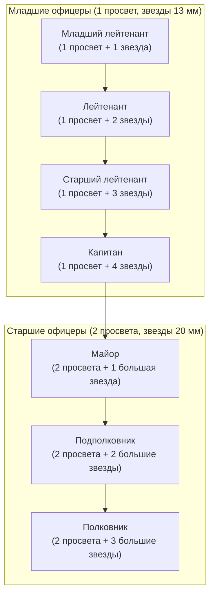

# Основы военной подготовки

- Писарев Олег Валерьевич
- "Здравия желаю, товарищ полковник. Разрешите войти."
- Глеб ~~без пива и~~ Раков молодец с зачётом со входа в двери
- 1969 год рождения
- Донецк - Москва - Горький (Нижний Новгород), Арзамас - Череповец (Ордена Жукова Военный университет радиоэлектроники)
- жена по званию "Старшая N"
- деньги - `лейтенант 60000 - полковник 180000 - пенсия 100000`
- заскучал, жена выпинала в ЧГУ
- в тёмной деревне определить по Церкви где север и юг
- в тёмном лесу, муравейник всегда с южной стороны
- 59 статья "Родину любить"
- медицину будет вести женщина (жгут на шею - валик, привязать к поднятой руке)
- меч на 7кг (бред)
- плохо что не смотрели игру престолов
- хватило на полчаса (Его), будем смотреть "Кино"

## Дни воинской славы

Согласно [Федеральный закон от 13.03.1995 N 32-ФЗ (ред. от 29.12.2025) "О днях воинской славы и памятных датах России"](https://www.consultant.ru/document/cons_doc_LAW_5978/) в Российской Федерации устанавливаются следующие дни воинской славы России:

1. 27 января - День полного освобождения Ленинграда от фашистской блокады (1944 год);
2. 2 февраля - День разгрома советскими войсками немецко-фашистских войск в Сталинградской битве (1943 год);
3. 23 февраля - День защитника Отечества;
4. 18 апреля - День победы русских воинов князя Александра Невского над немецкими рыцарями на Чудском озере (Ледовое побоище, 1242 год);
5. 9 мая - День Победы советского народа в Великой Отечественной войне 1941-1945 годов (1945 год);
6. 7 июля - День победы русского флота над турецким флотом в Чесменском сражении (1770 год);
7. 10 июля - День победы русской армии под командованием Петра Первого над шведами в Полтавском сражении (1709 год);
8. 9 августа - День первой в российской истории морской победы русского флота под командованием Петра Первого над шведами у мыса Гангут (1714 год);
9. 23 августа - День разгрома советскими войсками немецко-фашистских войск в Курской битве (1943 год);
10. 8 сентября - День Бородинского сражения русской армии под командованием М.И. Кутузова с французской армией (1812 год);
11. 11 сентября - День победы русской эскадры под командованием Ф.Ф. Ушакова над турецкой эскадрой у мыса Тендра (1790 год);
12. 21 сентября - День победы русских полков во главе с великим князем Дмитрием Донским над монголо-татарскими войсками в Куликовской битве (1380 год);
13. 4 ноября - День народного единства;
14. 7 ноября - День проведения военного парада на Красной площади в городе Москве в ознаменование двадцать четвертой годовщины Великой Октябрьской социалистической революции (1941 год);
15. 1 декабря - День победы русской эскадры под командованием П.С. Нахимова над турецкой эскадрой у мыса Синоп (1853 год);
16. 5 декабря - День начала контрнаступления советских войск против немецко-фашистских войск в битве под Москвой (1941 год);
17. 24 декабря - День взятия турецкой крепости Измаил русскими войсками под командованием А.В. Суворова (1790 год);

Дополнительные даты?:

- 12 мая - День победного завершения советскими войсками Крымской наступательной операции (1944 год);
- 9 августа - День окончания Ленинградской битвы (1944 год).
- 3 сентября - День Победы над милитаристской Японией и окончания Второй мировой войны (1945 год);
- 9 октября - День разгрома советскими войсками немецко-фашистских войск в битве за Кавказ (1943 год);

## Воинские уставы

> **Воинскими уставами** называются официальные нормативно-правовые документы, регламентирующие жизнь и деятельность войск в условиях мирного и военного времени.

Основные уставы:

### 1. Устав внутренней службы ВСРФ

> Настоящий устав определяет права и обязанности военнослужащих Вооружённых сил Российской Федерации (ВСРФ) и взаимоотношения между ними, обязанности основных должностных лиц полка и его подразделений, а также правила внутреннего порядка.

1) Самое маленькое подразделение ВСРФ - отделение (10 человек, дальше пехота).
2) 3 отделения - взвод.
3) 3 взвода - рота
4) 3 роты - батальон
5) 3 батальона - полк
6) 3 полка - дивизия (бригада?)
7) 3 дивизии - армия
8) 3 армии - фронт

### 2. Строевой устав ВСРФ

> Настоящий устав определяет строевые движения с оружием и без оружия, строи подразделений и воинских частей в пешем порядке и на машинах, порядок выполнения воинского приветствия, проведения строевого смотра, положение боевого знамени воинской части в строю, порядок совместного выноса и относа государственного флага РФ и боевого знамени воинской части, обязанности военнослужащих перед построением и в строю и требования к их строевому обучению, а также способы передвижения военнослужащих на поле боя и действия при внезапном нападении противника.

### 3. Дисциплинарный устав ВСРФ

> Настоящий устав определяет сущность воинской дисциплины, обязанности военнослужащих по её соблюдению, виды поощрений и дисциплинарных взысканий, права командиров по их применению, а также порядок подачи и рассмотрения обращений, предложений, заявлений и жалоб. 

> **Воинская дисциплина** есть строгое и точное соблюдение всеми военнослужащими порядка и правил, установленных законами РФ, общевоинскими уставами ВСРФ и приказами командиров.

Воинская дисциплина основывается на осознании каждым военнослужащим воинского долга, на личной ответственности за защиту РФ; строится на правовой основе, на уважении чести и достоинства военнослужащих.

Основным методом воспитания дисциплинированности является убеждение, при этом допускаются меры принуждения к военнослужащим, недобросовестно выполняющим воинский долг.

Поощрение является важным средством воспитания военнослужащих и укрепление воинской дисциплины. Применяются следующие меры поощрений:

1) снятие ранее применённого дисциплинарного взыскания;
2) объявление благодарности;
3) сообщение на Родину, либо по месту прежней работы/учёбы военнослужащего, об образцовом выполнении им воинского долга и полученных поощрениях;
4) награждение грамотой, ценным подарком или деньгами;
5) награждение личной фотографией военнослужащего, снятого при развёрнутом боевом знамени воинской части;
6) присвоение рядовым воинского звания рефрейтора;
7) досрочное присвоение очередного воинского звания , но не выше воинского звания звания, предусмотренного штатом;
8) присвоение очередного воинского звания на одну ступень выше воинского звания звания, предусмотренного штатом;
9) награждение нагрудным знаком отличника;
10) занесение в книгу почёта воинской части фамилии отличившегося военнослужащего;
11) награждение именным холодным и огнестрельным оружием.

Военнослужащий привлекается к дисциплинарной ответственности за дисциплинарный проступок.

> **Дисциплинарный проступок** — противоправное, виновное действие или бездействие, выражающееся в нарушении воинской дисциплины и не влекущее по законодательству уголовной или административной ответственности.

Военнослужащий привлекается к дисциплинарной ответственности только за тот дисциплинарный проступок,  в отношении которого установлена его вина.

> **Дисциплинарное взыскание** - установленная государством мера ответственности за дисциплинарный проступок, совершённый военнослужащим, и применяется в целях предупреждения совершения других дисциплинарных проступков.

1) выговор (пальчиком);
2) строгий выговор (двумя пальчиками);
3) лишение очередного увольнения из расположения воинской части или корабля;
4) лишение очередного нагрудного знака отличника;
5) предупреждение о неполном служебном соответствии (для контрактников);
6) снижение в воинской должности;
7) снижение в воинском звании на одну ступень;
8) снижение в воинском звании на одну ступень со снижением в воинской должности;
9) досрочное увольнение с военной службы в связи с невыполнением условий контракта;
10) отчисление из военного образовательного учреждения профессионального образования;
11) отчисления с военных сборов (сразу в армию призывают);
12) дисциплинарный арест.

### 4. Устав гарнизонной и караульной служб ВСРФ

> Настоящий устав определяет предназначение, порядок организации и несения гарнизонной, комендантской и караульной служб, права и обязанности должностных лиц гарнизона и военнослужащих, несущих эти службы, а также регламентирует проведение гарнизонных мероприятий с участием войск.

### 5. Устав военной полиции ВСРФ

#TODO

## Защита Отечества

> **Защита Отечества** - это деятельность государственной власти и общества, направленная на защиту территориальной целостности страны, нерушимости её границ.

### Обязанности военнослужащего

На основе Указа Президента РФ № 1495; редакция устава — от 24 июня 2025 года военнослужащий обязан:

1) быть верным Военной присяге, беззаветно служить народу РФ, мужественно, умело, не щадя своей крови и самой жизни защищать РФ, выполнять воинский долг, стойко выполнять обязанности военной службы;
2) строго соблюдать Конституцию и законы РФ, выполнять требования общевоинских уставов;
3) постоянно овладевать военными профессиональными знаниями, совершенствовать свою выучку и воинское мастерство;
4) знать и содержать в постоянной готовности к применению вверенные ему вооружение и военную технику, беречь военное имущество;
5) быть честным, дисциплинированным, храбрым, , при выполнении воинского долга проявлять разумную инициативу;
6) беспрекословно выполнять приказы командиров и защищать их в бою, оберегать боевое знамя воинской части;
7) дорожить войсковым товариществом, не щадя своей жизни выручать товарищей из опасности, помогать им словом и делом, уважать честь и достоинство каждого, не допускать в отношении себя и других военнослужащих грубости и издевательств, удерживать их от недостойных поступков;
8) воинской честью, боевой славой Вооружённых Сил, своей воинской части и честью воинского звания;
9) быть бдительным, строго хранить военную и государственную тайны.

Для солдата отдельно установлены дополнительные обязанности: знать начальников до командира дивизии включительно, соблюдать требования безопасности и т. д.

### Терроризм

> Метод, посредством которого организованная группа или партия стремятся достичь провозглашённых ей целей через систематическое использование насилия.

## Ответственность

1. Гражданско-правовая
2. Дисциплинарная
3. Уголовная
4. Материальная
5. #TODO

## Присяга

#TODO 

 Текст установлен статьёй 40 Федерального закона № 53-ФЗ «О воинской обязанности и военной службе».
 
> **«Я, (фамилия, имя, отчество), торжественно присягаю на верность своему Отечеству — Российской Федерации.**
> 
> **Клянусь свято соблюдать Конституцию Российской Федерации, строго выполнять требования воинских уставов, приказы командиров и начальников.**
> 
> **Клянусь достойно исполнять воинский долг, мужественно защищать свободу, независимость и конституционный строй России, народ и Отечество».**
 

## Воинское приветствие

#TODO 

## Подготовка к экзамену

Тест из 11 вопросов, нужно ответить на 8, с помощью преподавателя. При пересдаче - на 10 вопросов + дополнительные вопросы.

1. Обязанности военнослужащего.
2. Напишите текст Военной Присяги.
3. Что такое воинская дисциплина?
4. На чем основывается воинская дисциплина?	
5. За что военнослужащие привлекаются к дисциплинарной ответственности?	
6. Какие дисциплинарные взыскания могут применятся военнослужащим?
	
	Для **солдат, матросов, сержантов и старшин** предусмотрены:
	
	1) выговор;
	2) строгий выговор;
	3) лишение очередного увольнения из расположения воинской части или с корабля на берег;
	4) лишение нагрудного знака отличника;
	5) предупреждение о неполном служебном соответствии;
	6) снижение в воинской должности;
	7) снижение в воинском звании;
	8) снижение в воинском звании со снижением в воинской должности;
	9) досрочное увольнение с военной службы в связи с невыполнением условий контракта;
	10) дисциплинарный арест.
	
	При этом применимость отдельных взысканий зависит от того, проходит военнослужащий службу по призыву или по контракту. Для прапорщиков, мичманов и офицеров перечни отличаются.
	
7. Дайте определение «Что такое караул», какие бывают караулы?
	
	> **Караул — вооружённое подразделение, назначенное для выполнения боевой задачи по охране и обороне** боевых знамён, хранилищ, парков, вооружения, военной техники, другого военного имущества, военных и государственных объектов, а также для охраны военнослужащих, содержащихся на гауптвахте и в дисциплинарной воинской части.
	
	Караулы бывают:
	
	- **гарнизонные**;
	- **внутренние (корабельные)**.
	
	Они могут быть **постоянными** или **временными**.
	
8. Дайте определение кто такой «Часовой»?
	
	> **Часовой — вооружённый караульный, выполняющий боевую задачу по охране и обороне порученного ему поста.**
	
9. За что отвечает в карауле «Разводящий» и когда он имеет право применять оружие?
	
	Разводящий отвечает за **правильное и бдительное несение службы подчинёнными ему часовыми, своевременную смену и выставление их на посты, а также за правильную сдачу и приём часовыми постов**.
	
	Отдельные правила применения оружия разводящим установлены Уставом гарнизонной и караульной служб.
	
	#TODO Подробный порядок применения огнестрельного оружия
	
10. Обязанности «Разводящего».
	
	Основные обязанности разводящего:
	
	- знать свои посты, их расположение и границы, маршруты движения к ним;
	- знать условия охраны и обороны и особые обязанности часовых на постах;
	- принимать охраняемые объекты при выставлении часовых;
	- перед отправлением смены проверять знание караульными своих обязанностей;
	- докладывать начальнику караула о произведённой смене, состоянии постов и выявленных недостатках;
	- с разрешения начальника караула проверять несение службы подчинёнными часовыми;
	- при смене часовых контролировать правильность приёма и сдачи постов;
	- указывать заступающему часовому особенности охраны поста, соседние посты и опасные подступы;
	- проверять знание часовым порядка доклада и связи с караульным помещением.
	
	Это содержание обязанностей соответствует Уставу гарнизонной и караульной службы; часть обязанностей непосредственно связана с обращением с оружием, поэтому её операционные детали здесь не привожу.
	
11. Применение оружия «Часовым» в условиях плохой видимости.
	
	В условиях плохой видимости часовой продолжает выполнять **боевую задачу по охране и обороне поста** и действует в соответствии с Уставом гарнизонной и караульной служб.
	
	#TODO
	
	Сам факт плохой видимости **не является самостоятельным основанием для произвольного применения оружия**. Конкретные правила применения оружия часовым относятся к безопасному обращению с оружием и должны изучаться непосредственно по уставу и под руководством военного инструктора.
